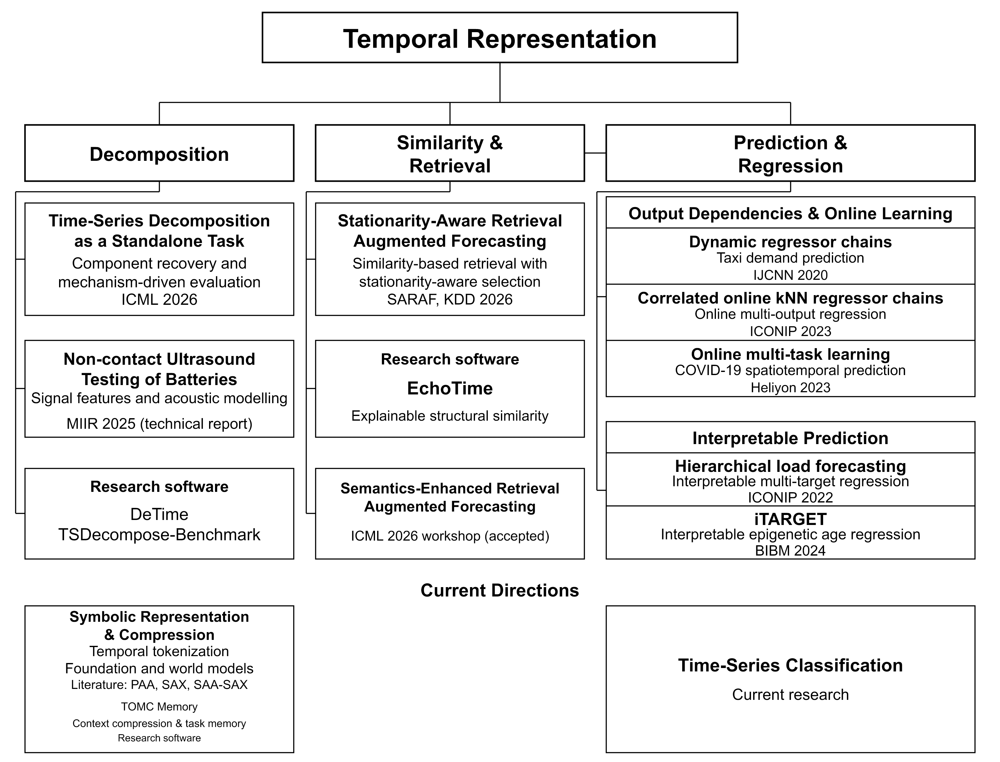

# Zipeng Wu

**Temporal representations · Time-series research software · AI task memory**

I am a PhD student at the University of Birmingham. I study how representations of temporal structure support AI, with current interests in how representations of temporal structure support foundation models,  world models and agent memory.

[Academic homepage](https://zipengwu.me/) · [Research and publications](RESEARCH_PROFILE.md) · [CV](https://zipengwu.me/cv.html) · [Google Scholar](https://scholar.google.com/citations?user=CROGdXYAAAAJ&hl=en) · [LinkedIn](https://www.linkedin.com/in/zipeng-wu-a98944189/) · [Email](mailto:zxw365@student.bham.ac.uk)

## Start here

| Looking for | Start with |
|---|---|
| Context preparation and explicit task memory for AI assistants | [TOMC Memory](https://github.com/ZipengWu365/TOMC) · [First-run guide](https://github.com/ZipengWu365/TOMC#first-run-tomc) · [Report your experience](https://github.com/ZipengWu365/TOMC/issues/11) |
| Explainable time-series comparison | [EchoTime](https://github.com/ZipengWu365/EchoTime) |
| Time-series decomposition software | [DeTime](https://github.com/systems-mechanobiology/DeTime) |
| A component-recovery benchmark for time-series decomposition | [TSDecompose-Benchmark](https://github.com/ZipengWu365/TSDecompose-Benchmark) |

**Follow this profile** for work across time-series representations, research software and AI memory. For a particular tool, use its repository's Star and Watch controls. Reproducible failures, documentation fixes and focused contributions are welcome; [start here](https://github.com/ZipengWu365/ZipengWu365/blob/main/community/README.md).

## Research notes

**28 October 2026 — [Saving Tokens: 13 Tools for Context Compression, Memory, and AI Handoffs](https://github.com/ZipengWu365/ZipengWu365/blob/main/notes/2026-10-28-saving-tokens-context-memory-handoffs.md)**

A practical roundup of context compression, persistent memory, and cross-assistant handoffs. Includes a reusable project handoff template, primary sources, and checks for evaluating token-saving claims.

**27 October 2026 — [Your prompt got smaller. Did your agent get worse?](https://github.com/ZipengWu365/ZipengWu365/blob/main/notes/2026-10-27-context-compression-checklist.md)**

A synthetic example involving a cancelled decision, a completed task and unfinished work. Includes an evaluation checklist separating token reduction, task quality, latency and actual cost. [中文版](https://github.com/ZipengWu365/ZipengWu365/blob/main/notes/2026-10-27-context-compression-checklist.zh.md).

[All research notes](https://github.com/ZipengWu365/ZipengWu365/tree/main/notes)

## Research map

My work connects decomposition, similarity and retrieval, and prediction and regression through temporal representations. Current directions include symbolic representation, compression and temporal tokenization. TOMC Memory extends the representation and compression direction to conversational context and explicit task notes.

[Detailed research profile and selected publications](RESEARCH_PROFILE.md) · [Editable research map](assets/temporal-representation-black-20261015-v5.pptx) · [Full publication list](https://zipengwu.me/publications.html)

## Interactive research visualizations

[NeurIPS 2026 Institution Atlas](https://github.com/ZipengWu365/neurips-institution-atlas) — an unofficial analysis of the 26 September 2026 snapshot. Counting rules and affiliation limitations are documented in the repository.

[Open the atlas](https://zipengwu365.github.io/neurips-institution-atlas/) · [UK edition](https://zipengwu365.github.io/neurips-institution-atlas/?view=united-kingdom)

## Participate

A useful first contribution can be a small synthetic failure case, a clear installation report or a correction to a research note. No follow, star or endorsement is required.

[TOMC first-run feedback — English / 中文](https://github.com/ZipengWu365/TOMC/issues/11) · [Contribution routes](https://github.com/ZipengWu365/ZipengWu365/blob/main/community/README.md)
